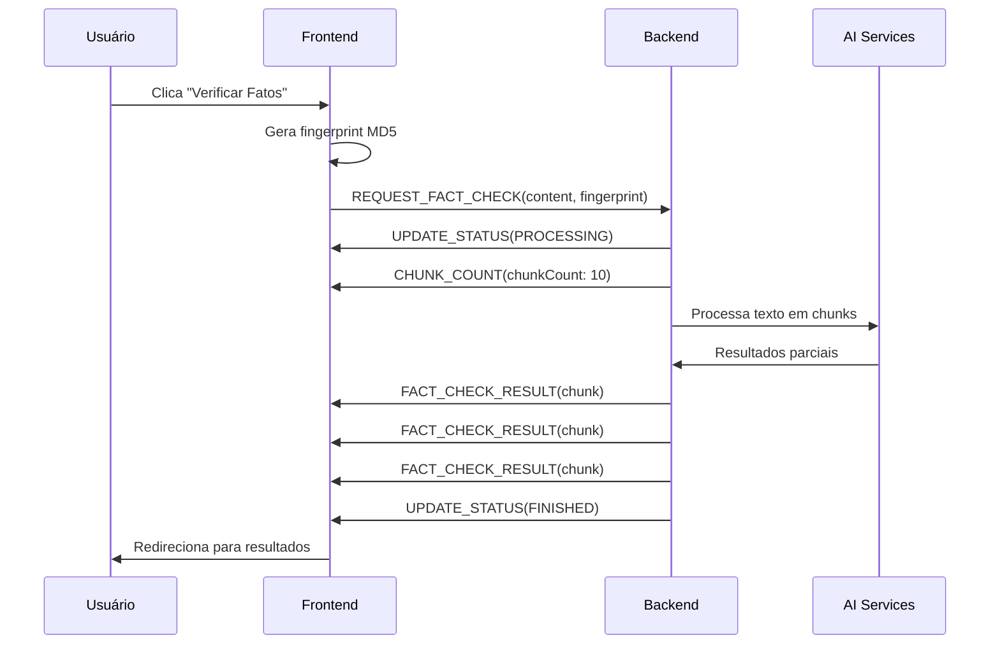

# Integração Frontend-Backend - Veritas Fact Checker

## Visão Geral

Esta integração conecta o frontend React/Next.js com o backend Node.js através de WebSocket usando Socket.IO para realizar verificação de fatos em tempo real.

## Arquitetura

### Frontend
- **Serviço**: `FactCheckService` - Gerencia conexão WebSocket e estados
- **Tipos**: `api.ts` - Interfaces TypeScript para comunicação
- **Configuração**: `api.ts` - Configurações centralizadas

### Backend
- **WebSocket Server**: Socket.IO com eventos específicos
- **Endpoint**: `REQUEST_FACT_CHECK` - Inicia verificação de fatos

## Como Funciona

### 1. Fluxo de Verificação



### 2. Estados da Verificação

- `idle` - Estado inicial
- `connecting` - Conectando ao WebSocket
- `processing` - Processando verificação
- `finished` - Verificação concluída
- `error` - Erro na verificação
- `interrupted` - Verificação interrompida

### 3. Eventos WebSocket

#### Cliente → Servidor
- `REQUEST_FACT_CHECK(content, request)` - Inicia verificação

#### Servidor → Cliente
- `UPDATE_STATUS(status)` - Atualiza status da verificação
- `FACT_CHECK_RESULT(result)` - Resultado parcial da verificação
- `CHUNK_COUNT(count)` - Informa quantidade de chunks que serão processados

## Uso

### Configuração Básica

```typescript
import { factCheckService } from '@/lib/services/factCheckService';

// Escuta mudanças de estado
const unsubscribe = factCheckService.onStateChange((state) => {
  console.log('Estado atual:', state.status);
  console.log('Resultados:', state.results);
  console.log('Chunks totais:', state.chunkCount);
  
  // Exemplo de tratamento específico do chunkCount
  if (state.chunkCount) {
    console.log(`Texto dividido em ${state.chunkCount} chunks para processamento`);
  }
});

// Inicia verificação
const fingerprint = await factCheckService.requestFactCheck(text, {
  researchThreshold: 0.5,
  apiKeys: {
    gemini: 'sua-chave-gemini',
    tavily: 'sua-chave-tavily'
  }
});

// Cleanup
unsubscribe();
```

### Configuração Avançada

```typescript
// 1) Configurar URL do backend via env (recomendado)
// .env.local
// NEXT_PUBLIC_BACKEND_URL=https://api.seuservidor.com

// 2) Ou instanciar com URL customizada
const customService = new FactCheckService('https://api.seuservidor.com');

// 3) Definir threshold por requisição (preferível a mutar config)
await factCheckService.requestFactCheck(texto, {
  researchThreshold: 0.8,
});
```

Observações:
- `API_CONFIG` é imutável; use env vars ou parâmetros de chamada.
- `requestFactCheck` garante a conexão automaticamente; `testConnection()` é opcional para diagnósticos.

## Estrutura de Dados

### FactCheckRequest
```typescript
interface FactCheckRequest {
  fingerprint: string;           // Hash MD5 único
  researchThreshold?: number;    // 0.0 - 1.0 (padrão: 0.5)
  apiKeys?: {
    gemini?: string;
    tavily?: string;
  };
}
```

### FactCheckResult
```typescript
interface FactCheckResult {
  data: {
    extractedClaim: string;      // Afirmação extraída
    reasoningConfidence: number; // Confiança do raciocínio (0-1)
    reasoning: string;           // Explicação do raciocínio
    flags?: string[];            // Flags de alerta
    sources?: string[];          // URLs das fontes
  };
  meta: {
    fingerprint: string;        // Fingerprint da sessão
    chunk: number;              // Número do chunk
    seq: number;                // Sequência do resultado
  };
}
```

### ChunkCount
```typescript
interface ChunkCountData {
  chunkCount: number;
}

interface ChunkCount {
  data: ChunkCountData;
  meta: {
    fingerprint: string;
  };
}
```

**Exemplo de payload:**
```json
{
  "meta": {
    "fingerprint": "random_hash"
  },
  "data": {
    "chunkCount": 10
  }
}
```

## Configuração de Ambiente

### Variáveis de Ambiente

```bash
# .env.local
PORT=3001
NEXT_PUBLIC_BACKEND_URL=http://localhost:3000

# (opcionais) ajustes de cliente
NEXT_PUBLIC_DEFAULT_RESEARCH_THRESHOLD=0.5
NEXT_PUBLIC_WEBSOCKET_TIMEOUT=10000
NEXT_PUBLIC_MAX_RETRY_ATTEMPTS=3
NEXT_PUBLIC_RETRY_DELAY=1000

# (opcionais) API Keys expostas no cliente
# NEXT_PUBLIC_GEMINI_API_KEY=sua-chave-gemini
# NEXT_PUBLIC_TAVILY_API_KEY=sua-chave-tavily
```

### Configuração do Backend

O backend deve estar rodando na porta configurada (padrão: 3000) com WebSocket habilitado.

## Tratamento de Erros

### Tipos de Erro

1. **Erro de Conexão**: Falha ao conectar com o backend
2. **Erro de Validação**: Texto vazio ou inválido
3. **Erro de Processamento**: Falha na verificação
4. **Erro de Interrupção**: Verificação cancelada

### Exemplo de Tratamento

```typescript
try {
  const fingerprint = await factCheckService.requestFactCheck(text);
} catch (error) {
  if (error.message.includes('conexão')) {
    // Mostrar erro de conexão
  } else if (error.message.includes('vazio')) {
    // Mostrar erro de validação
  } else {
    // Mostrar erro genérico
  }
}
```

## Debugging

### Logs Úteis

```typescript
// Habilitar logs detalhados
console.log('Estado da verificação:', factCheckService.getState());
console.log('Conectado:', factCheckService.isConnected());

// Logs automáticos no console:
// - "Conectado ao backend WebSocket"
// - "Resultado recebido: {result}"
// - "Status atualizado: {status}"
// - "Contagem de chunks: {chunkCount}"
```

### Ferramentas de Debug

1. **DevTools**: Network tab para verificar WebSocket
2. **Console**: Logs automáticos do serviço
3. **React DevTools**: Estado dos componentes

## Performance

### Otimizações Implementadas

- **Singleton Service**: Uma instância por aplicação
- **Cleanup Automático**: Desconexão ao desmontar componentes
- **Estado Reativo**: Atualizações eficientes via listeners
- **Fingerprint Único**: Evita duplicação de requisições

### Limites

- **Timeout**: 10 segundos para conexão
- **Retry**: Não implementado (pode ser adicionado)
- **Rate Limiting**: Não implementado (backend responsável)

## Troubleshooting

### Problemas Comuns

1. **"Erro ao conectar com o servidor"**
   - Verificar se o backend está rodando
   - Verificar URL de configuração
   - Verificar firewall/proxy

2. **"Verificação não inicia"**
   - Verificar se o texto não está vazio
   - Verificar console para erros
   - Verificar se WebSocket está conectado

3. **"Resultados não aparecem"**
   - Verificar se os listeners estão registrados
   - Verificar se o estado está sendo atualizado
   - Verificar se o componente está renderizando

### Soluções

```typescript
// Resetar serviço
factCheckService.reset();
factCheckService.disconnect();

// Reconectar
await factCheckService.connect();

// Verificar estado
console.log(factCheckService.getState());
```

## Próximos Passos

1. **Implementar Retry Logic**: Tentativas automáticas em caso de falha
2. **Adicionar Rate Limiting**: Controle de requisições por usuário
3. **Implementar Cache**: Cache de resultados para textos similares
4. **Adicionar Métricas**: Monitoramento de performance
5. **Implementar Offline Mode**: Funcionalidade offline básica
